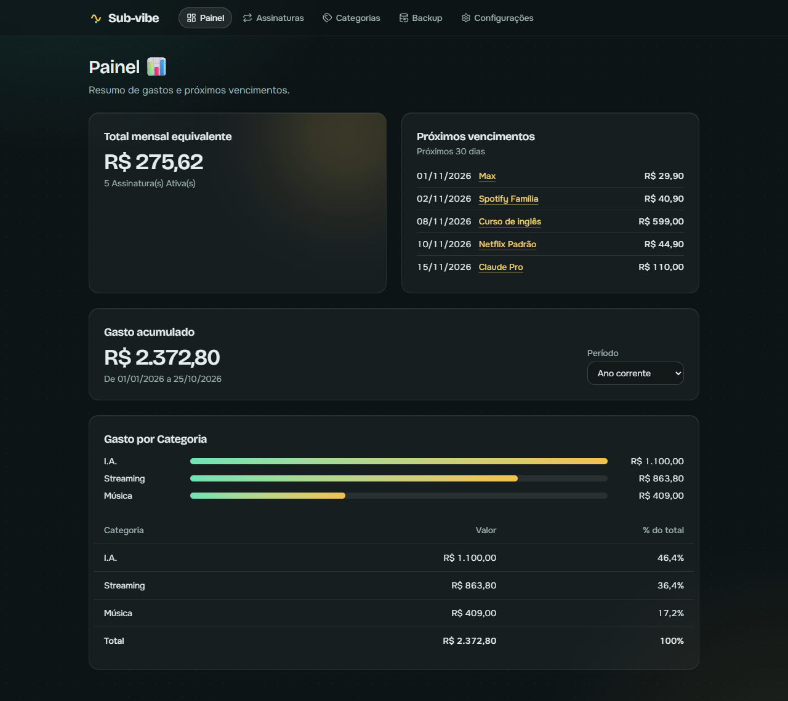

# Sub-vibe

App pessoal para registrar Assinaturas recorrentes (streaming, cursos, I.A. e o que mais você pagar todo mês) e acompanhar gastos e vencimentos. Nenhum pagamento passa pelo app: ele só organiza o que você já paga.

**Acesse:** https://l3-v1.github.io/sub-vibe/



## Funcionalidades

- **Painel:** Total mensal equivalente, Próximos vencimentos, Gasto acumulado e Gasto por Categoria no período escolhido (ano corrente, últimos 12 meses ou desde o início).
- **Assinaturas:** cadastro com Período gratuito opcional, filtros por estado e Categoria, linha do tempo das Vigências, próximas Cobranças, cancelamento, Reativação e "desfazer último registro".
- **Categorias:** criar, renomear e excluir, movendo as Assinaturas para outra Categoria.
- **Backup:** exportar e importar um arquivo JSON, com prévia antes de substituir os dados.
- **Configurações:** janela de Próximos vencimentos e tema escuro ou claro.

## Seus dados ficam no navegador

Não há servidor nem login: tudo fica no IndexedDB do navegador em que você usa o app. Por isso:

- os dados não passam de um navegador ou aparelho para outro sozinhos;
- limpar os dados do site apaga as Assinaturas;
- **exporte um backup de tempos em tempos** (tela Backup) e guarde o arquivo em outro lugar. Para levar os dados a outro navegador, exporte num e importe no outro.

## Stack

React 19, Vite, TypeScript, Tailwind CSS v4, React Router, Dexie (IndexedDB), Zod, date-fns e ícones Lucide. Testes com Vitest e Testing Library.

## Rodando localmente

Requer Node.js LTS.

```bash
npm install
npm run dev        # servidor de desenvolvimento
npm test           # testes
npm run lint       # oxlint
npm run build      # checagem de tipos + build de produção
npm run preview    # serve o build em http://localhost:4173/sub-vibe/
```

Cada push na `main` roda lint, testes e build, e publica no GitHub Pages (`.github/workflows/deploy.yml`).

## Estrutura

```
src/
  domain/     regras puras: Vigências, Cobranças, custos e Painel
  db/         Dexie, esquemas Zod, repositórios e backup
  features/   telas: painel, assinaturas, categorias, backup, configuracoes
  shared/     layout, formatação pt-BR, diálogo, avisos e estilos
```

## Documentação

- [GLOSSARY.md](GLOSSARY.md): vocabulário do domínio (Assinatura, Vigência, Cobrança...).
- [docs/adr](docs/adr): decisões de arquitetura, como [app só no navegador](docs/adr/0001-app-somente-no-navegador-com-indexeddb.md) e [Cobranças calculadas a partir das Vigências](docs/adr/0002-cobrancas-calculadas-a-partir-de-vigencias.md).
